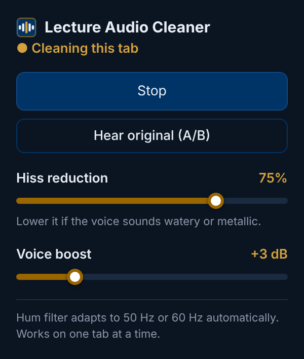
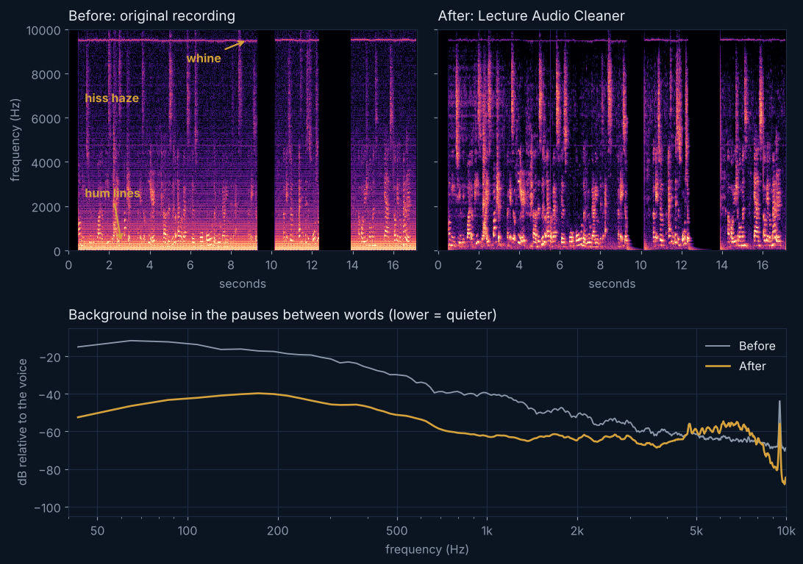
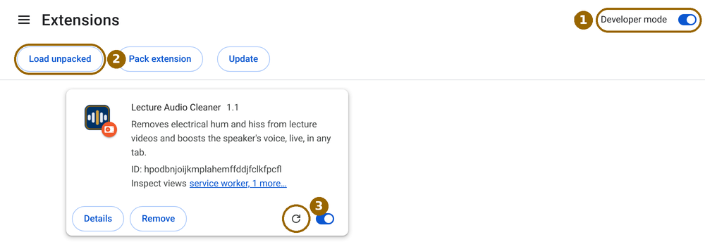
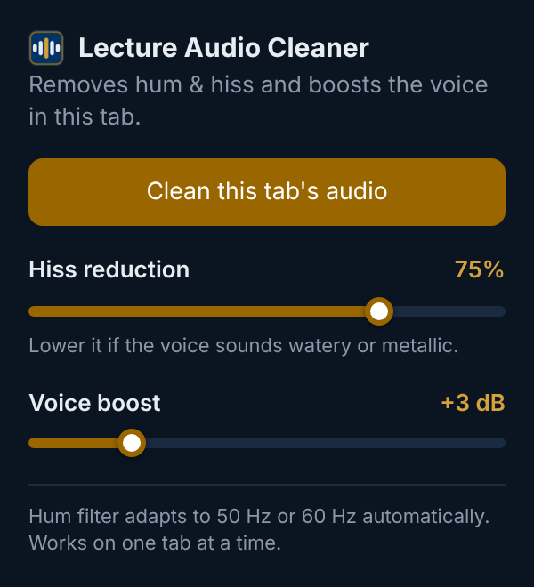
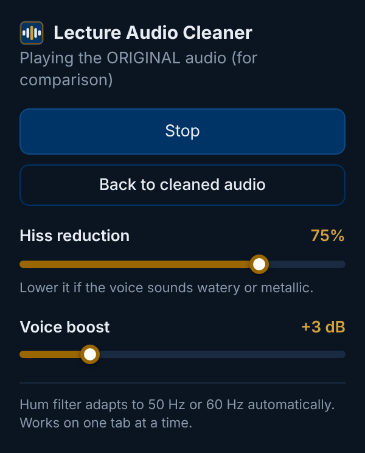
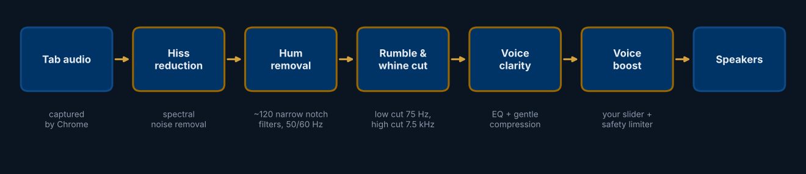

# Lecture Audio Cleaner

A Chrome extension that cleans up lecture recordings **live, while they play**. It removes:

- the electrical hum,
- background hiss,
- high-pitched whines,

and makes the speaker's voice louder and more even.

It works on any website that plays video or audio, including Canvas, Panopto, Zoom recordings and YouTube. You don't need to download anything.



---

## Contents

1. [What problem it solves](#what-problem-it-solves)
2. [What it does to the audio](#what-it-does-to-the-audio)
3. [Install](#install)
4. [How to use it](#how-to-use-it)
5. [The controls](#the-controls)
6. [Tips and troubleshooting](#tips-and-troubleshooting)
7. [Privacy](#privacy)
8. [How it works (technical)](#how-it-works-technical)
9. [Files](#files)

---

## What problem it solves

Many classroom recordings pick up noise from the room's electrics. A typical recording has:

- **Hum:** a constant low buzz at 50 Hz (60 Hz in North America), plus a ladder of overtones at 100, 150, 200 Hz and so on.
- **Hiss:** a steady "shhh" from the microphone and recording chain.
- **Whine:** a faint high-pitched tone from electronics, around 9.5 kHz in the recording this was built for.

On top of that, the speaker is often quiet or uneven, with some words loud and others hard to hear.

Lecture videos usually can't be downloaded, so this extension fixes the sound as it reaches your speakers.

## What it does to the audio

The picture below comes from a real HKUST lecture clip. The top half shows a *spectrogram*: time runs left to right, pitch runs bottom to top, and brighter means louder.

- **Before:** you can see the horizontal hum lines along the bottom, the whine line at the top, and a purple haze of hiss everywhere.
- **After:** the hum lines are gone and the space between the words is much darker. The voice is untouched.



The lower chart measures the background noise in the pauses between words, relative to the voice:

| Frequency range | What's there | Change |
|---|---|---|
| Below 300 Hz | Hum and room rumble | **20–35 dB quieter** (the hum is effectively gone) |
| 300 Hz – 2 kHz | Hiss in the main speech range | **15–20 dB quieter** |
| 2 – 4.5 kHz | Hiss in the upper speech range | **2–10 dB quieter** |
| Above 4.5 kHz | Faint high hiss | About the same as before. The voice-levelling step lifts quiet moments, which cancels out the hiss reduction here |
| 9.5 kHz whine | Electrical whine | Cut to well below hearing level |

The voice itself also comes out louder and more even, at about the loudness of a YouTube video or a podcast.

## Install

You only do this once. It works in **Chrome, Edge, Brave and Arc** on Mac or Windows, but not Safari or Firefox.

1. **Unzip** this folder somewhere you'll keep it, such as Documents. The browser loads the extension from this folder, so don't delete it afterwards.
2. Go to **`chrome://extensions`** (or `edge://extensions` in Edge).
3. Turn on **Developer mode** in the top-right corner. This is ① in the picture below.
4. Click **Load unpacked** (②) and choose the unzipped folder, the one that contains `manifest.json`.
5. Click the puzzle-piece icon in the toolbar and **pin** Lecture Audio Cleaner so its icon is always visible.



**To update to a new version later:** replace the files in that folder, then click the reload arrow (③) on the extension's card.

> Chrome may sometimes show a banner saying developer-mode extensions are enabled. That's normal for extensions installed this way. Close it.

## How to use it

1. Open the lecture and start playing it.
2. Click the **Lecture Audio Cleaner** icon in the toolbar.
3. Press **Clean this tab's audio**.

That's it. The icon shows a gold **ON** badge on that tab while it's working. To turn it off, open the popup again and press **Stop**.

| Before you start | While cleaning | Comparing with the original |
|---|---|---|
|  |  |  |

## The controls

**Clean this tab's audio / Stop**
: Turns the cleanup on or off for the tab you're looking at.

**Hear original (A/B)**
: Switches to the untouched audio so you can hear the difference. Press **Back to cleaned audio** to return. The switch is instant, so it's easy to compare.

**Hiss reduction** (0–100%, default 75%)
: How strongly the background hiss is removed.
- Higher means a quieter background.
- If the voice starts to sound watery, metallic or "underwater", turn it down to 50–60%.
- At 0%, hiss reduction is off, but the hum and whine are still removed.

**Voice boost** (0 to +15 dB, default +3 dB)
: Extra loudness for the speaker's voice. A safety limiter stops loud moments from distorting, even at the maximum.

Your slider settings are saved and reused next time.

**Automatic: 50 Hz vs 60 Hz**
: The hum filter listens for the first few seconds and switches to 60 Hz if the recording was made somewhere with 60 Hz power, such as the US. You don't need to set anything.

## Tips and troubleshooting

| Situation | What to do |
|---|---|
| The first second or two still sounds hissy | Normal. The hiss reducer needs about 2 seconds to learn the background noise, and again after you pause. |
| The voice sounds watery or metallic | Lower **Hiss reduction**. |
| It's still too quiet | Raise **Voice boost**. The video player's own volume also still works. |
| You opened another lecture in a new tab | The cleanup follows one tab at a time. Click the icon on the new tab and press the button again. |
| "Chrome doesn't allow this on its own pages" | Chrome blocks extensions on `chrome://` pages and the Web Store. Use it on a normal website. |
| Another audio extension is running on the same tab | Chrome allows only one extension to capture a tab's audio at a time, so turn the other one off first. This includes Cassette Tape. |
| The video and sound look slightly out of sync | The added delay is a few hundredths of a second, which most people can't notice. If you do notice it, pause and play again. |
| You see an error after pressing the button | Reload the page and try again. If it keeps happening, reload the extension from `chrome://extensions`. |

## Privacy

- **All processing happens on your computer**, inside the browser.
- **No audio is recorded, saved or sent anywhere,** and the extension makes no network requests at all.
- It only touches a tab's audio after you press the button on that tab, and it stops as soon as you press Stop or close the tab.

## How it works (technical)



1. **Capture.** When you press the button, Chrome's `tabCapture` API hands the tab's audio to a hidden "offscreen" page. Chrome mutes the tab, and the extension plays the processed audio back to you instead.
2. **Hiss reduction.** A spectral noise reducer runs as an `AudioWorklet`. It splits the sound into 513 frequency bands roughly 170 times a second and estimates the steady noise floor in each band over a rolling window of about 2.4 seconds. It then turns down the bands that are only noise. The gain is smoothed over time and frequency to avoid "musical noise" artefacts. This runs first, on the raw audio, so it can recognise true silence when the video is paused.
3. **Hum removal.** About 120 very narrow notch filters sit on 50 Hz and every overtone up to 6 kHz, or on 60 Hz and its overtones. The notches are kept narrow enough not to overlap, so the voice in between passes through untouched.
4. **Rumble and whine cut.**
   - A 75 Hz low cut removes rumble.
   - A steep 7.5 kHz high cut (8th-order Butterworth) removes the whine and high hiss. Speech intelligibility sits below this.
5. **Voice clarity.** A small dip at 250 Hz reduces boominess, and a lift at 3 kHz adds presence. A compressor then evens out loud and quiet words.
6. **Voice boost and limiter.** Your boost setting is applied, followed by a brick-wall limiter that prevents clipping.

## Files

```
manifest.json          extension definition (Manifest V3, Chrome 116+)
popup.html / popup.js  the popup window
background.js          starts and stops tab capture
offscreen.html / .js   hidden page where the audio is processed
dsp.js                 builds the audio processing chain (Web Audio API)
denoise-worklet.js     the spectral hiss reducer
icon16/32/48/128.png   toolbar icons
images/                pictures used in this README
```
